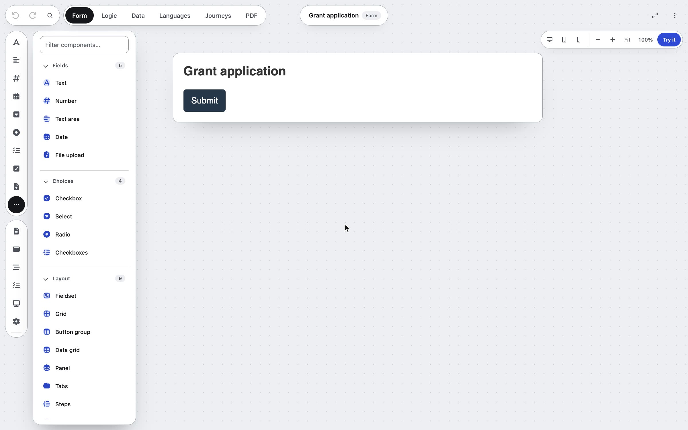
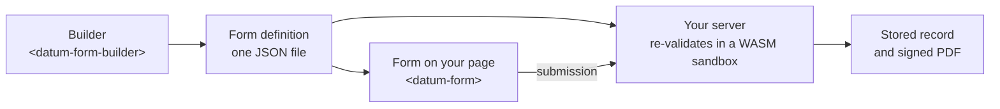

# Datum

**Sovereign forms.** Datum is open-source forms infrastructure you run yourself. Define a form
once, deliver it as a web form, a PDF or a printed page, and keep the forms and the records in
your own hands.

[Website and live demo](https://datum.argusvane.com) ·
[Documentation](https://datum.argusvane.com/docs/) ·
[Contributing](CONTRIBUTING.md)



## The problem

Forms that end up as records (applications, intake, registrations, declarations) usually go one
of two ways.

- **A hosted form service.** It is quick to start, but the answers sit on someone else's servers,
  the form looks like their product instead of yours, and moving away later is expensive.
- **Built by hand.** You own it, but every form is its own small project. The validation is
  written once for the browser and again for the server, and the two drift apart. The PDF is a
  separate piece of work. The next form starts from zero.

Datum is a third way: a form is one file that you own, and a small set of open-source parts turns
that file into everything else.

## What you get

- **One definition.** A form is a single JSON file holding its fields, data model, rules, pages
  and PDF layouts. It lives in your repository and is reviewed like any other change.
- **A visual builder.** `<datum-form-builder>` lets people build and edit forms without writing
  code. What it saves is that same JSON file.
- **Drop-in web components.** `<datum-form>` loads with a `<script>` tag on any page. No
  framework is required.
- **Your look.** A form is drawn by a binding. Datum's own `datum` binding is built in and is the
  one official look. Nine reference bindings under `bindings/` (the GC Design System, USWDS, GOV.UK,
  Bootstrap, Nova Scotia, Alberta, Québec, Ontario and Fluent UI) draw the same form with those design systems'
  own markup and components; they are starting points and demos that own their own accessibility,
  not products. You can write your own without touching the engine. Datum is not affiliated with
  or endorsed by any of those design systems or the organisations behind them; their names and
  artwork are theirs.
- **Validation you can rely on.** The same validation program runs in the browser and again on
  your server, inside a WebAssembly sandbox. Both sides reach the same answer, and the server
  never accepts a submission it has not checked itself.
- **PDFs and signatures.** The form renders to PDF from its own layouts, or fills a PDF template
  you already have. PDFs can be tagged for accessibility, produced as PDF/A and digitally signed.
- **Multi-page journeys.** One form can be asked a page at a time, with pages that appear or are
  skipped depending on the answers.
- **Tests for forms.** Short scenarios kept with the form check its rules and paths, in the
  browser and on the server.
- **Nothing phones home.** Datum's own look and code fetch nothing from a third party: every asset
  is a file you host. A form runs air-gapped, in the browser alone or behind your own server
  ([air-gapped deployments](https://datum.argusvane.com/docs/air-gapped)). A design-system
  binding may load fonts, icons or images from a third-party host (Google Fonts, Adobe Fonts or the
  design system's own site); [the table in Design-system bindings](https://datum.argusvane.com/docs/bindings#hosting-the-files)
  lists each.

## How it works



1. **Build.** Someone designs the form in the builder, or writes the JSON directly. Either way the
   result is one definition file.
2. **Deliver.** The engine reads the definition and draws it on your page, through
   the binding you choose. Rules and validation run as the person fills it in.
3. **Check.** On submit, your server runs the same validation program in a WebAssembly sandbox.
   The browser's word is never taken for it.
4. **Record.** The accepted submission is stored where you decide, and the same definition
   produces the PDF record.

The engine at the centre is plain TypeScript and knows nothing about HTML frameworks. The form,
the builder, print and PDF are all views over the same form state, which is why they agree with
each other.

## A quick taste

Load the form from a CDN, point it at a definition, and listen for the submission:

```html
<link rel="stylesheet" href="https://cdn.jsdelivr.net/npm/@argusvane/datum@0.1.0/dist/datum-form.css">
<script type="module" src="https://cdn.jsdelivr.net/npm/@argusvane/datum@0.1.0/dist/datum-form.js"></script>

<datum-form src="/forms/intake.json"></datum-form>

<script type="module">
  document.querySelector("datum-form").addEventListener("datum-submit", ({ detail }) => {
    if (detail.accepted) console.log(detail.submission);
  });
</script>
```

The builder embeds the same way with `<datum-form-builder>` (`datum-builder.css` and
`datum-builder.js`).

The CDN is the quickest way to try it. To host the files yourself, `npm install @argusvane/datum`
puts them in `node_modules/@argusvane/datum/dist/`, and each
[GitHub release](https://github.com/Argusvane/datum/releases) attaches them as an archive.
[Files you host](https://datum.argusvane.com/docs/files) says what each file is and how to serve
them, from your own server or from a CDN. The package's `dist/integrity.json` lists the sha384 of
every file, so a page that loads them from a CDN can pin each one (`integrity` and `crossorigin` on
the tags above, an import map for the chunks, `wasm-integrity` for the sandbox module); see
[Pinning the files](https://datum.argusvane.com/docs/files#pinning-the-files).
[Getting started](https://datum.argusvane.com/docs/getting-started) takes this page, step by
step, to a form you designed yourself and a server that receives it.
[The form on your page](https://datum.argusvane.com/docs/form-on-your-page) covers data
sources, error handling and delivery.

## Run it locally

You need Node 22 (see [`.nvmrc`](.nvmrc)) and npm. There is no root install: each package has its
own `package.json` and lockfile, and `npm run setup` installs the ones you name, in dependency order.

```sh
git clone https://github.com/argusvane/datum.git
cd datum
nvm use

npm run setup -- engine packages/quickjs-wasm-host packages/pdf-kernel packages/datum
npm run datum:build      # writes packages/datum/dist/
npm run datum:demo       # demo pages on http://localhost:4173/
```

The demo pages show the form, the builder, a journey, sandbox validation and the PDF designer,
loaded the way any page would load them.

The documentation pages are the Markdown files in [`site/docs`](site/docs/). To read them
rendered, from the clone, run `npm run site:setup` once and then `npm run site:docs-dev`, which
serves the text on http://localhost:5173/docs/. The live examples need the bundles from the
`datum:build` step above, copied in by `npm run site:demo-assets`, and the server that serves them:
run `npm run site:dev` instead, which serves the docs with their live examples.

[CONTRIBUTING.md](CONTRIBUTING.md) and the
[development reference](docs/reference/development.md) list the commands for every other part of
the repository.

## What is in the repository

| Path | What it is |
|---|---|
| [`engine/`](engine/) | The form engine: the definition format, rules, validation, journeys, the builder's logic and the renderer. |
| [`bindings/`](bindings/) | Reference bindings that draw the form with a design system's own markup: GC Design System, USWDS, GOV.UK, Bootstrap, Nova Scotia, Alberta, Québec, Ontario and Fluent UI. |
| [`packages/datum/`](packages/datum/) | `<datum-form>` and `<datum-form-builder>` as ready-to-load bundles, with demo pages. |
| [`packages/pdf-kernel/`](packages/pdf-kernel/) | Turns a form and its answers into a PDF: layouts, template fill, tagging, PDF/A and signing. |
| [`packages/quickjs-wasm-host/`](packages/quickjs-wasm-host/) | The WebAssembly sandbox that runs validation the same way in the browser and on a server. |
| [`packages/form-test/`](packages/form-test/) and [`packages/conformance-suite/`](packages/conformance-suite/) | Test runners: one for a form's own scenarios, one that checks a server against the validation contract. |
| [`integrations/`](integrations/) | Server hosts for [Spring Boot](integrations/jvm/README.md) and [FastAPI](integrations/fastapi/README.md). |
| [`site/`](site/) | The project site, its live demo and the documentation site with live examples. |
| [`docs/`](docs/README.md) | Guides, reference pages and the architecture decision records. |

## Server hosts

The browser components work on their own. A server host adds what a browser cannot be trusted
with: re-validating submissions, rendering and signing PDFs, and storing records.

- **Spring Boot** (Java 17+): [`integrations/jvm/`](integrations/jvm/README.md), with a
  [first run](https://datum.argusvane.com/docs/spring-boot#first-run) in the documentation.
- **FastAPI** (Python 3.12+): [`integrations/fastapi/`](integrations/fastapi/README.md), with a
  [first run](https://datum.argusvane.com/docs/fastapi#first-run) in the documentation.
- **Anything else** that can run WebAssembly can run the same programs.
  [Your own server](https://datum.argusvane.com/docs/server-programs) has the protocol, with
  the endpoint in Python, Java, C# and Node.js.

## Project status

Datum is pre-release (0.1.0). [Release status](https://datum.argusvane.com/docs/introduction#release-status)
says what is published and what to expect from a 0.x release, and [CHANGELOG.md](CHANGELOG.md) records
the changes. It is a good time to try it, read the code and tell us what is missing: see
[SUPPORT.md](SUPPORT.md) for where to ask.

## Learn more

The [documentation site](https://datum.argusvane.com/docs/) is the place to learn Datum:

- [Getting started](https://datum.argusvane.com/docs/getting-started): from the build to a
  form on your page, a form you designed and its answers on a server.
- [Publishing a form](https://datum.argusvane.com/docs/publishing): from the builder's
  Download to a working page.
- [Rules and formulas](https://datum.argusvane.com/docs/formulas): how a form's rules are
  written.
- [PDFs](https://datum.argusvane.com/docs/pdf): layouts, templates and signing.
- [Writing a binding](https://datum.argusvane.com/docs/writing-a-binding): bringing your own
  design system.

In the repository, for people working on Datum itself:

- [Contributor reference](docs/README.md): the internal guides and reference pages.
- [Architecture decisions](docs/adr/README.md): why things are built the way they are.

## Contributing

Issues and pull requests are welcome, whether that is a bug report, a fix, a binding for another
design system or a host for another server framework. [CONTRIBUTING.md](CONTRIBUTING.md) explains
the setup and the tests to run, and [CODE_OF_CONDUCT.md](CODE_OF_CONDUCT.md) describes how we work
together.

Found a security problem? Please report it privately as described in [SECURITY.md](SECURITY.md)
instead of opening a public issue.

## Licence

Copyright (c) 2026 Argusvane. Datum is released under the MIT licence ([LICENSE](LICENSE)). Vendored fonts and other third-party assets keep their own licences,
listed in [THIRD_PARTY_NOTICES.md](THIRD_PARTY_NOTICES.md). Government design-system artwork,
such as the Government of Canada signature and wordmark, has its own terms and is not covered by
MIT.
